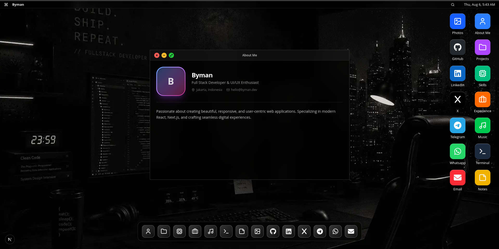
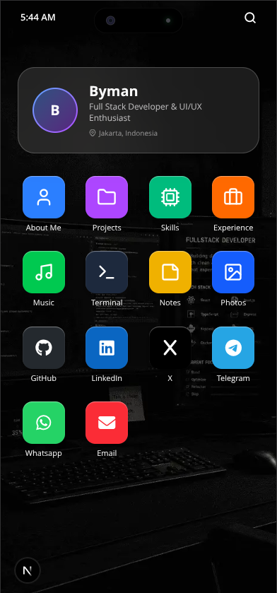

# VanshOs 🚀

A visually stunning, responsive portfolio website that mimics **macOS on desktop** and **iOS on mobile** — all in a single codebase. Built with Next.js 16, Tailwind CSS, and Framer Motion.

> **Desktop** → Draggable windows, traffic lights, dock magnification, Spotlight Search, desktop icons.
> **Mobile** → Dynamic Island, swipeable apps, iOS-style home grid, Hero Card widget.

### 💻 Desktop Experience


### 📱 Mobile Experience
<p align="center">
  
</p>

## Features ✨

- **macOS Desktop View** — Draggable & resizable windows, working traffic lights (close / minimize / maximize), desktop icons, and a magnifying dock.
- **iOS Mobile View** — Safe areas, Dynamic Island animation, swipe-to-close apps, Hero Card widget, and a home screen icon grid.
- **Boot Screen** — A macOS-style boot animation with customizable logo (Lucide icon or custom image) and progress bar.
- **Spotlight Search** — Functional search overlay on both Desktop and Mobile to quickly find and open any app.
- **Deep Linking** — URL-based routing (`/projects`, `/skills`, etc.) that auto-opens the corresponding window/app.
- **Font Awesome Social Icons** — Social media links render proper brand icons from Font Awesome 6.
- **Glassmorphism** — Beautiful backdrop blurs, translucent panels, and soft shadows.
- **Smooth Animations** — Powered by Framer Motion for springy, native-feeling interactions.
- **Data-Driven Architecture** — All content is sourced from `src/data/portfolio.ts`. All apps are defined in a central `src/data/appRegistry.ts`.
- **Modular App System** — Add new "apps" (windows/screens) without touching core layout code.
- **Dynamic Wallpaper** — Easily swap the background from `portfolio.ts`.
- **Spotify-Style Music Player** — Built-in functional music app with a custom audio engine, tracklist, and responsive layout for both Desktop and Mobile!

## Tech Stack 🛠

| Technology | Version | Purpose |
|---|---|---|
| Next.js | 16 (App Router) | Framework & routing |
| React | 19 | UI library |
| TypeScript | Strict mode | Type safety |
| Tailwind CSS | v4 | Styling |
| Framer Motion | Latest | Animations |
| Lucide React | Latest | UI Icons |
| Font Awesome | 6.7 | Social media icons |

## Local Setup 🚀

1. **Clone the repository**
   ```bash
   git clone https://github.com/byma4n/bymanOS.git
   cd bymanOS
   ```

2. **Install dependencies**
   ```bash
   npm install
   ```

3. **Run the development server**
   ```bash
   npm run dev
   ```

4. Open [http://localhost:3000](http://localhost:3000) in your browser.

## Deployment 🌐

The easiest way to deploy your BymanOS portfolio is using [Vercel](https://vercel.com/):

1. Push your code to your GitHub repository.
2. Log in to Vercel and click **Add New Project**.
3. Import your GitHub repository.
4. Leave the default settings (Next.js framework) and click **Deploy**.

Within seconds, your portfolio will be live with a free `.vercel.app` domain (or you can add a custom domain).
## Project Structure 📁

```
src/
├── app/                        # Next.js App Router
│   ├── layout.tsx              # Root layout (metadata, fonts, Font Awesome CDN)
│   └── [[...slug]]/            # Optional catch-all route (deep linking)
│       └── page.tsx            # Entry point — extracts app ID from URL
├── components/
│   ├── desktop/                # macOS-inspired components
│   │   ├── DesktopView.tsx     # Main desktop layout
│   │   ├── MenuBar.tsx         # Top menu bar with clock & search
│   │   ├── Dock.tsx            # Bottom dock with magnification
│   │   ├── MacWindow.tsx       # Draggable window component
│   │   └── windows/            # Individual window contents
│   │       ├── AboutWindow.tsx
│   │       ├── ProjectsWindow.tsx
│   │       ├── SkillsWindow.tsx
│   │       ├── ExperienceWindow.tsx
│   │       ├── MusicWindow.tsx
│   │       └── index.ts        # Barrel export
│   ├── mobile/                 # iOS-inspired components
│   │   ├── MobileView.tsx      # Main mobile layout (with Hero Card)
│   │   ├── StatusBar.tsx       # Status bar + Dynamic Island
│   │   └── sections/           # Individual app screens
│   │       ├── AboutApp.tsx
│   │       ├── ProjectsApp.tsx
│   │       ├── SkillsApp.tsx
│   │       ├── ExperienceApp.tsx
│   │       ├── MusicApp.tsx
│   │       └── index.ts        # Barrel export
│   └── shared/                 # Shared components
│       ├── SpotlightSearch.tsx # Search overlay (used by both views)
│       ├── BootScreen.tsx      # Boot animation with customizable logo
│       ├── Wallpaper.tsx       # Dynamic wallpaper
│       ├── GlassCard.tsx       # Glassmorphism card
│       ├── TechBadge.tsx       # Tech stack badges
│       ├── SocialIcon.tsx      # Font Awesome social icon resolver
│       └── appComponents.tsx   # App ID → React component map
├── data/
│   ├── appRegistry.ts          # App definitions (icons, visibility, sizing)
│   ├── experience.ts           # Work history timeline
│   ├── notes.ts                # Notes app data
│   ├── photos.ts               # Photos app data
│   ├── playlist.ts             # Music player playlist
│   ├── portfolio.ts            # Theme and meta configurations
│   ├── profile.ts              # Personal info and social links
│   ├── projects.ts             # Project portfolio
│   ├── skills.ts               # Categorized skills
│   └── socialApps.ts           # Social media color definitions
├── lib/
│   ├── utils.ts                # Utility functions (cn)
│   └── iconResolver.tsx        # Icon name → Lucide component resolver
└── types/
     └── portfolio.ts            # TypeScript interfaces
```

## Customization 🎨

### Change Your Content

All content is modularly organized in the `src/data/` directory. Edit the following files to update your portfolio:

- [`src/data/profile.ts`](src/data/profile.ts) — name, role, bio, avatar, location, resume link, and social links
- [`src/data/projects.ts`](src/data/projects.ts) — title, description, tech stack, links for projects
- [`src/data/skills.ts`](src/data/skills.ts) — categorized skill list with proficiency levels
- [`src/data/experience.ts`](src/data/experience.ts) — work history timeline
- [`src/data/playlist.ts`](src/data/playlist.ts) — audio URLs, cover URLs, title, artist for the Music Player
- [`src/data/photos.ts`](src/data/photos.ts) — image URLs and captions for the Photos app
- [`src/data/notes.ts`](src/data/notes.ts) — your notes for the Notes app

### Change the Wallpaper

In `portfolio.ts`, update the `theme.wallpaperUrl` field:

```ts
theme: {
  wallpaperUrl: "/background/your-image.png",
}
```

Place your image in the `public/background/` folder.

### SEO & Open Graph

All SEO metadata is configured in [`src/app/layout.tsx`](src/app/layout.tsx). Update these fields to match your identity:

```ts
metadataBase: new URL("https://yourdomain.com"),
openGraph: {
  url: "https://yourdomain.com",
  siteName: "YourName",
  title: "Your Name — Your Role",
  images: [{ url: "/screenshot/desktop.png" }],
},
twitter: {
  creator: "@yourhandle",
},
```

Replace `public/screenshot/desktop.png` with your own screenshot for a compelling social media preview card.

### Customize the Boot Screen Logo

The boot screen logo can be a **Lucide icon** or a **custom image**:

```ts
// Using a Lucide icon
theme: {
  wallpaperUrl: "/background/bg.png",
  bootLogo: {
    type: "icon",
    value: "Command"    // Any icon registered in iconResolver.tsx
  }
}

// Using a custom image
theme: {
  wallpaperUrl: "/background/bg.png",
  bootLogo: {
    type: "image",
    value: "/my-custom-logo.png"  // Path relative to public/
  }
}
```

### Deep Linking (URL Routing)

Every app is accessible via a direct URL:

| URL | Opens |
|---|---|
| `/` or `/about` | About Me |
| `/projects` | Projects |
| `/skills` | Skills |
| `/experience` | Experience |
| `/music`    | Music Player               |
| `/notes`    | Notes Application          |
| `/photos`   | Photos Gallery             |
| `/terminal` | Command Line Interface     |

Share `https://yourdomain.com/projects` and visitors land directly in the Projects window (desktop) or Projects app (mobile).

### Social Media Icons

Social links in `portfolio.ts` use the `icon` field to render **Font Awesome 6** brand icons. Supported values:

`github` · `linkedin` · `twitter` · `instagram` · `facebook` · `youtube` · `dribbble` · `behance` · `figma` · `discord` · `tiktok` · `telegram` · `whatsapp` · `threads` · `medium` · `email` · `website`

To add more, extend the map in [`src/components/shared/SocialIcon.tsx`](src/components/shared/SocialIcon.tsx) and assign its color in [`src/data/socialApps.ts`](src/data/socialApps.ts).

**Note:** The system automatically generates a standalone "App" (icon on Desktop, Dock, and Mobile screen) for every platform you register in `socialLinks`, which links directly to your profile.

### Add a New App

Adding a new "app" (e.g., Blog) requires **3 simple steps**:

**Step 1** — Create the component files:

```
src/components/desktop/windows/BlogWindow.tsx   # Desktop version
src/components/mobile/sections/BlogApp.tsx       # Mobile version
```

**Step 2** — Register in [`src/components/shared/appComponents.tsx`](src/components/shared/appComponents.tsx):

```tsx
// Add to desktopComponentMap
blog: (data) => <BlogWindow data={data} />,

// Add to mobileComponentMap
blog: (data) => <BlogApp data={data} />,
```

**Step 3** — Add entry in [`src/data/appRegistry.ts`](src/data/appRegistry.ts):

```ts
{
  id: "blog",
  label: "Blog",
  iconName: "BookOpen",
  iconColor: "text-rose-400",
  mobileColor: "bg-rose-500",
  windowSize: { maxWidth: "max-w-3xl", height: "h-[600px]" },
}
```

Done! The app automatically appears in Desktop Icons, Dock, and Mobile Home Screen.

#### Visibility Controls

Each app supports granular visibility:

```ts
showOnDesktop: false,   // Hide from desktop icons
showOnDock: false,       // Hide from dock
showOnMobile: false,     // Hide from mobile home
```

## Contributing 🤝

Contributions are welcome! Please read [`CONTRIBUTING.md`](CONTRIBUTING.md) for details on our code of conduct, and the process for submitting pull requests.

## License 📝

This project is licensed under the MIT License — see the [LICENSE](LICENSE) file for details.
